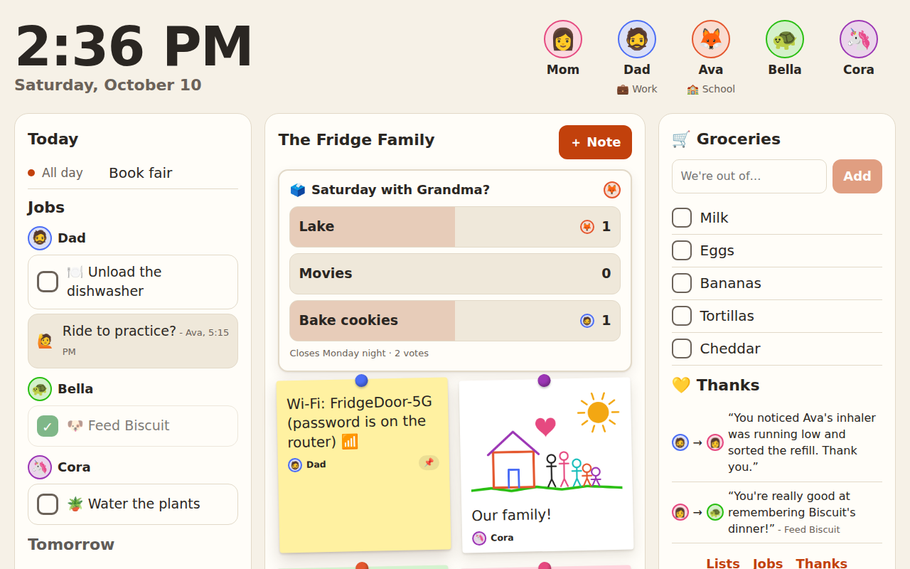
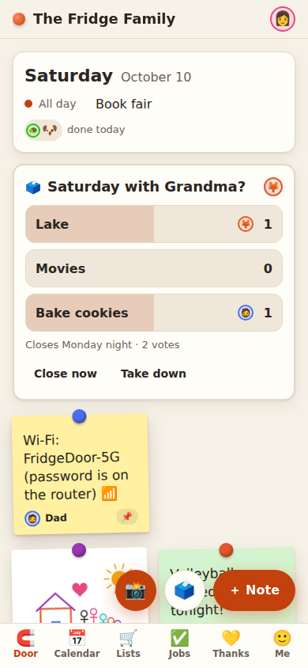
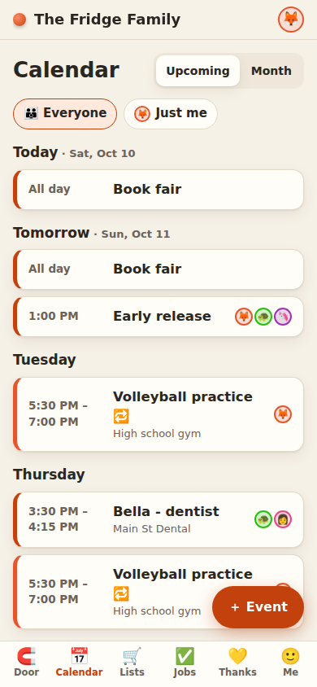
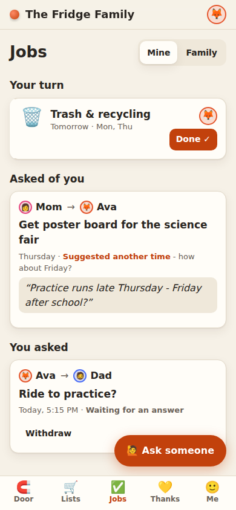

# Fridge Door

Our family's fridge door, in an app: a free-form note board, shared lists, requests and recurring family jobs. It runs as an always-on **wall view** on a cheap kitchen tablet and as an installable web app (PWA) on everyone's phone.

It copies the paper fridge's best qualities. Anyone can post, rearrange and take things down, and the grocery list sits next to a doodle and a "love you" note. It's deliberately small and boring, so it stays reliable and doesn't turn into a second job for whoever maintains it.

| Kitchen wall | Phone |
|---|---|
|  |  |

| Family calendar | Requests and jobs |
|---|---|
|  |  |

## Try it in a minute (no accounts)

```bash
npm install
npm run demo
```

Open <http://localhost:5173> and pick a device: Mom's phone, Dad's phone, Ava's phone, or the Kitchen wall. The demo runs the real backend code against an in-memory database with a sample family. On the wall, Bella's PIN is **1234**. Restarting the demo resets everything.

## What's in version 1

| | What it does |
|---|---|
| 🧲 **The door** | Sticky notes with a colour, an author, an optional photo or doodle, and "for everyone" or "for [person]". **📸 snaps a photo with the phone's camera** straight onto the door. Each note is **pinned**, or lasts **today**, **this week** or **until removed**. Expired notes take themselves down. Drag to rearrange. Anyone can take a note down; it can be put back for 30 days. Only a parent can delete it for good. |
| 🗳️ **Quick polls** | "Pizza or tacos Friday?" Two to six choices; everyone taps a vote (and can change it). Polls close tonight, tomorrow, in 3 days or in a week, show the winner for a day, then tidy themselves away. |
| 🖼️ **Art wall** | Every photo and drawing that's ever been on the door, month by month, kept after it comes down. Put a favourite back on the door with one tap. |
| 🛒 **Shared lists** | Groceries first, then any list. Updates instantly everywhere, and anyone can add. Each list has an **owner** who does the noticing, planning, buying and checking, plus an optional agreed "standard" ("never out of milk, bread or fruit"). *Who owns what* shows every area on one screen for a weekly re-deal. |
| 🙋 **Requests, not assignments** | Ask someone for something. They answer **Yes**, **Another time** (and suggest one), or **Can't** (and say why). A request isn't proof anyone agreed to it. |
| ✅ **Recurring family jobs** | Rotations that include the grown-ups. Schedules are "every N days, counted from when it was actually done" or fixed weekdays. Credit goes to whoever did it. "Not today" pushes it to tomorrow, and a mis-tap can be undone for 10 minutes. |
| 🖼️ **Wall view** (`/wall`) | Big clock, today's calendar, each person's jobs (tap to tick off), open requests, the door, groceries and recent thanks. Large type for reading across a kitchen. It dims at night, shows the last known state if the Wi-Fi drops, and can wake the screen when a note goes up. |
| 👪 **Profiles** | Parents sign in with email and password. Kids don't need accounts: they tap their picture on the wall (plus a 4-digit PIN, if they have one), or a parent pairs their phone with a one-time code. Everyone gets a private **My space**. |
| 💛 **Thanks** | A feed of what got done for the family this week, with **specific** thanks. The thanks box nudges toward praising the other person ("you're really good at…", "you noticed…"). There are no points, totals per person or leaderboards. |
| 🔔 **Quiet notifications** | Off until each person turns them on for their own device. One evening summary, plus a ping only for things that are time-sensitive for you, held until your quiet hours end. Never reminders about undone chores. |
| 📅 **Family calendar** | Built in. Events at a time or all day (up to a month long), with a place and notes. **Repeating events** (daily, weekly on chosen days, every other week, monthly, yearly), where you can change or delete one date or every date. **Tag who's involved**; their avatars show, and "Just me" filters to your events. Anyone adds; whoever added it (or a parent) can change it. Upcoming list and month view. Tomorrow's events (yours first) go in the evening summary. An optional read-only .ics feed (school, team) can be shown alongside. |
| 💾 **Your data** | One-tap JSON export for parents, a nightly snapshot (last 14 kept), and an optional nightly POST to your own storage. |
| ✨ **Updates** | New versions install themselves in the background; if the app is open, it shows "A new version of the fridge is ready - Refresh". **Me → This device** shows which version you're on. See [docs/updating.md](docs/updating.md). |

**Deliberately left out so far:** points, stars and allowance; meal planning and pantry tracking; barcodes and grocery delivery; syncing with Google/Apple calendars; location; chat threads; SMS; and every AI feature. The reasons are in [docs/design-notes.md](docs/design-notes.md). Use the core for a few weeks before adding anything.

## Set it up for your family

You need Node 20+, a free [Convex](https://www.convex.dev) account (the backend), and somewhere free to host a static site (Cloudflare Pages, Netlify or Vercel). It takes about 30–45 minutes.

### 1. Backend (Convex)

```bash
npm install
npx convex dev          # log in, create a project (e.g. "fridge")
```

`convex dev` pushes the backend to a development deployment and writes `VITE_CONVEX_URL` to `.env.local`. Leave it running and start the app in a second terminal with `npm run dev:frontend`, or run `npm run dev` to start both. Open <http://localhost:5173>.

### 2. Notifications (optional, recommended)

```bash
npx web-push generate-vapid-keys
npx convex env set VAPID_PUBLIC_KEY  <public key>
npx convex env set VAPID_PRIVATE_KEY <private key>
npx convex env set VAPID_SUBJECT     mailto:you@example.com
```

For production, run the same `env set` commands with `--prod` added. On iPhone and iPad, notifications need iOS 16.4+, and each person must first **Add to Home Screen** and open the app from there.

### 3. Put it online

Create a site on Cloudflare Pages, Netlify or Vercel from this repo, with:

- **Build command:** `npx convex deploy --cmd "npm run build"`
- **Output directory:** `dist`
- **Environment variable:** `CONVEX_DEPLOY_KEY`, a *production* deploy key from the Convex dashboard (Project settings → Deploy keys)

That one build command deploys the backend and builds the app pointing at it. SPA routing is handled by `public/_redirects` (Netlify, Cloudflare Pages) and `vercel.json` (Vercel).

### 4. First run

1. Open your site. The first visitor sets up the household and becomes its first parent. After that, set-up closes, so strangers can't create households on your backend.
2. **Me → ⚙️ Family settings → Add someone** for each person. Use first names and a picture. Kids don't need email addresses.
3. **Second parent:** *Give a login*, then they open the site, tap **I have a code**, enter it and choose their own email and password.
4. **Kids' phones (optional):** *Connect their phone* creates a one-time code. The phone stays signed in as that kid.
5. **Wall PINs:** worth setting once kids are old enough to tap in as a sibling.
6. **Calendar:** add the regulars in the **Calendar** tab: practices, lessons, pizza night, birthdays (repeat yearly). If the school or a team publishes a calendar link ("Subscribe" or "iCal"), *Family settings → Outside calendars* can show it alongside, read-only. (Whether Quitman ISD offers one is unknown; check the district calendar page.)
7. Everyone: open the site on your phone and **Add to Home Screen**.

### 5. The kitchen tablet

- Any Android tablet running **[Fully Kiosk Browser PLUS](https://www.fully-kiosk.com/)** (€8.90 per device, one-time). Set the start URL to `https://your-site/wall`, then pair it from **Family settings → Devices → Set up the wall tablet**.
- In Fully: enable *Motion detection* (camera wake), a night screen-off schedule, and **Advanced Web Settings → Enable JavaScript Interface**. With the interface on, the wall wakes the screen when a new note goes up.
- Android: set the browser's battery use to *Unrestricted* so Wi-Fi doesn't drop.
- **Battery:** don't leave it at 100% forever, because batteries swell. Put the charger on a smart plug that keeps it around 40–80%.
- Mount it with command strips at a height the youngest can reach. Test a cheap tablet for a month before considering a big display.
- The wall dims itself from 9pm to 6am. A tapped-in person is signed out of the wall after 2 idle minutes, or when they tap **Done**.

## How a family uses it

- **Anyone can post, move or take down notes**, and parents follow the same rules as kids.
- **Owners, not assignees.** Every list or area has one owner who does the anticipating and checking. Agree on owners and standards at a short weekly "re-deal" at the family table (**Lists → Who owns what**), and let the app remember them.
- **Ask, don't assign.** "Can't" is a fine answer.
- **Thank specifically**, and thank the invisible stuff: "you noticed we were out of milk".
- **No surveillance.** There's no location, no automatic read receipts and no "last seen". "Got it" is something the recipient taps. Status (Home / Out / School / Work / Practice / Away) is optional, the same for everyone, and clears at midnight. **My space** is private, from parents too.
- **Success looks like** your daughters and your partner posting notes, claiming jobs and thanking each other without being asked, with kid art next to the grocery list.

## Security and privacy, honestly

- Parent passwords are hashed with scrypt. Every device gets its own session token (stored hashed), and a parent can sign out any device from Family settings.
- **Wall PINs are not real security.** They're 4 digits and lock for 5 minutes after 5 wrong tries, which is enough to stop siblings posing as each other. Anything powerful (managing people and devices, deleting for good, calendars, export) needs a parent's real password sign-in, never a PIN on the wall.
- Login attempts lock for 15 minutes after 5 failures. Pairing codes work once and expire after 15 minutes.
- **My space** is hidden from everyone in the app, including parents, and is never exported. Whoever administers the Convex project can still technically read the database.
- Keep kids' data light: first names and an emoji. Photos go to your own Convex storage and nowhere else. There's no analytics and no third-party scripts.

## Your data

- **Family settings → Your data → Download everything (JSON):** notes, lists, requests, jobs, completions, thanks and calendar links. Password/PIN hashes, tokens and private spaces are excluded.
- A snapshot is saved every night (the last 14 are kept). Set `EXPORT_WEBHOOK_URL` (and optionally `EXPORT_WEBHOOK_SECRET`) to have each night's JSON POSTed to storage you control.
- For a full backup including photos: `npx convex export --prod --include-file-storage --path fridge-backup.zip`.
- The data layer is a thin set of files in `convex/`, so moving to a self-hosted backend (e.g. PocketBase) later is a weekend job, not a rewrite.

## Development

```
convex/        backend: schema, functions, crons (lib/ = shared helpers)
src/           the PWA: pages, components, service worker (sw.ts)
demo/          in-memory backend for `npm run demo` (convex-test inside Vite)
tests/         backend unit tests (Vitest + convex-test)
e2e/           end-to-end tests (Playwright, against the demo)
docs/          design notes and screenshots
```

| Command | |
|---|---|
| `npm run demo` | Try the app with sample data, no accounts |
| `npm run dev` | Convex dev deployment + Vite |
| `npm test` | 74 backend tests: auth, permissions, privacy, lifespans, rotations, requests, repeating events, polls, art wall, digest, calendar parsing, export |
| `npm run e2e` | 12 end-to-end flows in a phone-sized browser (run `npx playwright install chromium` once) |
| `npm run typecheck` / `npm run build` | Type-check everything / production build |
| `npm run icons` | Re-render the PNG icons from `public/favicon.svg` |

`convex/_generated/` is committed, as Convex recommends. `npx convex dev` regenerates it when functions change.

## Shipping updates

`main` is the live app; changes go to a work branch, get a Vercel Preview against your test backend, and go live when you merge. The one-time Vercel settings, the day-to-day steps, and how to roll back are in **[docs/updating.md](docs/updating.md)**.

## What's next

In the order the research suggests, and only once the core has been in daily use for a few weeks:

1. **A Claude connector** (a remote MCP server) with tools like `add_item`, `add_task`, `get_today` and `post_message`, so "add poster board, due Thursday" works from your phone.
2. **Free-text capture** that splits one sentence into a list item plus a request, shown as a card to confirm.
3. **Email-in and photo-of-a-flyer** feeding a *proposed events* queue. An adult confirms everything, inbound mail is treated as untrusted, and the AI never deletes anything.

Every AI result should land in a "proposed changes" queue that an adult confirms.
